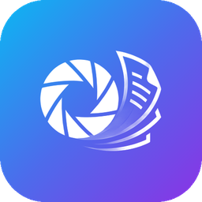

<p align="center"></p>

# Pix2Doc

Android app that turns images into a PDF. Original pixels are kept as they are, no recompression.

**English** · [עברית](#עברית)

## Features

- **Share to convert.** Select photos in the gallery, tap Share, choose Pix2Doc. The PDF is built in the background, no screen opens, and a notification offers Open, Share and Reorder pages.
- **In-app pickers.** Choose photos, image files from any folder, or open an existing PDF.
- **Page order.** Images keep the order they were sent in. Reorder by drag, or sort by original file name or photo date (EXIF, falling back to file date). Reverse order is one tap.
- **Quality.** JPEG files are embedded untouched. PNG stays lossless. HEIC and WebP are re-encoded once at JPEG quality 95. EXIF rotation is applied to the page, not the pixels. Optional 300 dpi cap for smaller files, off by default.
- **Print-ready.** A4 by default: image scaled to fit, aspect ratio preserved, orientation follows the image, 5 mm margin. Letter and "page = image size" are available.
- **Saving.** Saved to `Download/Pix2Doc`, or to a folder you choose. Optional "ask where to save every time". Editing an existing PDF overwrites it by default, with Save as for a new file.
- **Languages.** Hebrew and English, switchable in Settings.

## Install

1. Open the [latest release](../../releases/latest) on your phone.
2. Download the `.apk` and open it. Allow installing from unknown sources when asked.
3. Releases are signed with a fixed key, so a newer APK installs over an older one.

Requires Android 10 or newer. On Android 13 and newer, allow notifications. Without them you get a short toast instead of the completion notification.

## Notes and limits

- Sorting by file name or date works only for PDFs created by Pix2Doc, which store each page's source name and date. Other PDFs can be reordered manually.
- A PDF received through Share is read-only. Overwrite is not possible for it, so use Save as.
- Very large non-JPEG images (for example 48 MP HEIC) need a lot of memory to re-encode.
- The app can't open itself from the background, so there is no auto-open. Use the notification's Open button.

## Build

Requires JDK 17 and the Android SDK.

```
./gradlew testDebugUnitTest assembleDebug
```

The APK is written to `app/build/outputs/apk/debug/`. GitHub Actions runs the tests, builds the APK and publishes a Release on every push to `main` that changes code.

Built with Kotlin, [PdfBox-Android](https://github.com/TomRoush/PdfBox-Android), RecyclerView with ItemTouchHelper, and the platform `PdfRenderer` for page previews.

---

## עברית

אפליקציית אנדרואיד שהופכת תמונות לקובץ PDF, בלי לדחוס מחדש ובלי לפגוע באיכות.

**תכונות**
- **שיתוף מהגלריה:** בוחרים תמונות, שיתוף, Pix2Doc. ה-PDF נוצר ברקע בלי לפתוח מסך, וההתראה מציעה פתיחה, שיתוף וסידור דפים.
- **בחירה בתוך האפליקציה:** תמונות, קבצי תמונה מכל תיקייה, או פתיחת PDF קיים.
- **סדר הדפים:** כפי שנשלחו. אפשר לגרור, למיין לפי שם קובץ או תאריך צילום, או להפוך סדר.
- **איכות:** JPEG נשמר כמות שהוא. PNG ללא אובדן. HEIC ו-WebP מומרים פעם אחת ל-JPEG באיכות 95.
- **להדפסה:** A4 כברירת מחדל, התאמה עם שמירת יחס, כיוון אוטומטי ושוליים של 5 מ״מ.
- **שמירה:** `Download/Pix2Doc`, או תיקייה שבוחרים, או שאלה בכל פעם. עריכת PDF קיים דורסת אותו כברירת מחדל, ואפשר לשמור כקובץ חדש.
- **שפה:** עברית ואנגלית.

**התקנה:** מורידים את ה-APK מ-[הגרסה האחרונה](../../releases/latest), פותחים אותו ומאשרים התקנה ממקור לא מוכר. נדרש אנדרואיד 10 ומעלה.

**מגבלות:** מיון לפי שם או תאריך עובד רק ב-PDF שנוצר ב-Pix2Doc. PDF שהתקבל בשיתוף הוא לקריאה בלבד, ולכן שומרים אותו כקובץ חדש.
